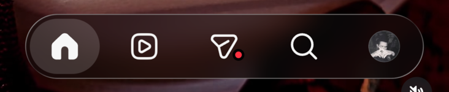
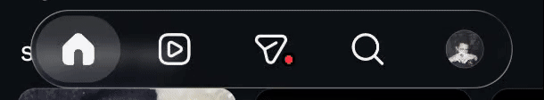
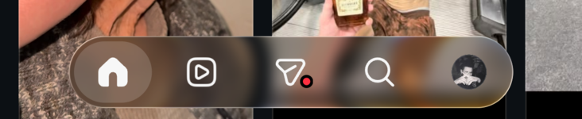
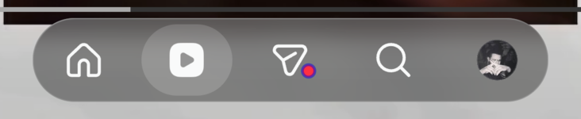

# igglass

An LSPosed module that gives Instagram for Android's tab bar an iOS 26-style *liquid glass* look. It only changes how things look: it doesn't touch the account, the network or any data.





## Features

- **Floating bar.** The bar's opaque background is replaced by a glass capsule with blur, saturation and a lens that bends the edges. Content scrolls underneath it.
- **Selection pill.** It slides between tabs with spring physics and stretches as it accelerates. You can also drag it with your finger: let go and it settles on the nearest tab.
- **Touch response.** Pressing the bar makes it grow slightly, brightens it under your finger, and lets it follow your finger with rubber-band resistance.
- **Shrinks on scroll.** Scrolling down the feed shrinks the bar; scrolling up brings it back.

  

- **Full-screen Reels.** The video fills the screen, and its UI (buttons, caption and scrubber) sits above the capsule.

  

- **Glass over videos.** Instagram draws videos in a `SurfaceView` that the app itself can't capture, so the module asks the system compositor for the blur instead.

## Requirements

- Android 13 or later (uses `RuntimeShader`, API 33).
- Root and LSPosed, or a compatible fork such as Vector.
- Tested with Instagram **450.0.0.50.77** on Android 17 (POCO X6 Pro).

Use a test account: Instagram can detect root and LSPosed, and this module makes no attempt to hide them.

## Build and install

```bash
./gradlew assembleRelease
adb install -r app/build/outputs/apk/release/app-release.apk
```

1. In LSPosed (or Vector), enable **IG Liquid Glass** and tick Instagram in its scope.
2. Force-stop Instagram: `adb shell am force-stop com.instagram.android`.
3. Open Instagram.

## Settings

Every parameter is documented in [`GlassParams.kt`](app/src/main/java/com/maciasdxv/igglass/GlassParams.kt): capsule size, blur, lens, highlight, tint, touch response, shrinking and Reels. After changing them, rebuild and reinstall.

These switches work without reinstalling. They take effect when you leave Instagram and come back:

```bash
adb shell setprop debug.igglass.off 1    # disable the module
adb shell setprop debug.igglass.off 0    # enable it again
adb shell setprop debug.igglass.dump 1   # dump the view tree (diagnostics)
adb logcat -s IGGlass                    # module log
```

## How it works

| File | What it does |
|---|---|
| `HookEntry.kt` | Hooks on system classes (`Activity`, `View`, `ViewGroup`, `SurfaceView`), never on Instagram's obfuscated classes |
| `TabBarGlass.kt` | Finds the bar by resource ID and sets everything else up |
| `CapsuleGlassDrawable.kt` | The capsule: records what's behind it into a `RenderNode` and applies blur → saturation → lens |
| `GlassPillDrawable.kt`, `PillMotion.kt` | The pill and its physics |
| `PillDragView.kt` | Tells taps from drags; taps are forwarded to Instagram untouched |
| `BarPressEffect.kt` | Press, rubber band and shrinking |
| `LayoutGuard.kt` | Pins Instagram's margins before they're applied, so the bar doesn't jump |
| `VideoBlur.kt` | A compositor layer that blurs `SurfaceView` videos |
| `Shaders.kt` | Commented AGSL shaders |

Any failure is logged and only disables the part that failed; Instagram never crashes because of the module.

## When an Instagram update breaks it

The module anchors to **resource names**, not numeric IDs or obfuscated classes. If Instagram renames one, the affected part stops applying and the log says so. To fix it:

1. Turn on the dump (`setprop debug.igglass.dump 1`), open the affected screen, and pull the file with `adb pull /sdcard/Android/data/com.instagram.android/files/igglass/`.
2. Find the new name and update it in `TabBarGlass.kt`.

Names in use:

- **Bar:** `tab_bar`, `tab_bar_shadow` and the tabs `feed_tab`, `clips_tab`, `direct_tab`, `search_tab`, `profile_tab`.
- **Layout:** `layout_container_center_right_coordinator_layout`, `swipeable_tab_view_pager`, `layout_container_main`.
- **Reels:** `clips_viewer_view_pager`, `clips_video_container`, `clips_ufi_component`, `clips_bottom_legibility_gradient_component`, `scrubber`.

Glass over videos relies on hidden `SurfaceControl` methods. If an Android release removes them, the log will show `blur de video: NO disponible` and videos will look sharp under the capsule.

## Credits and license

AGSL shaders from [Kyant0/backdrop](https://github.com/Kyant0/backdrop) (Apache-2.0).

Released under the **MIT** license (see [LICENSE](LICENSE)).

A personal research project, not affiliated with Meta or Instagram.
